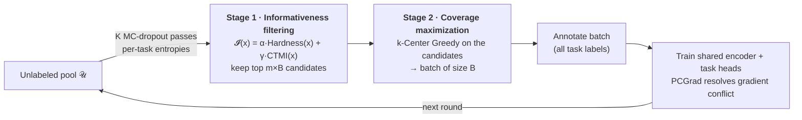
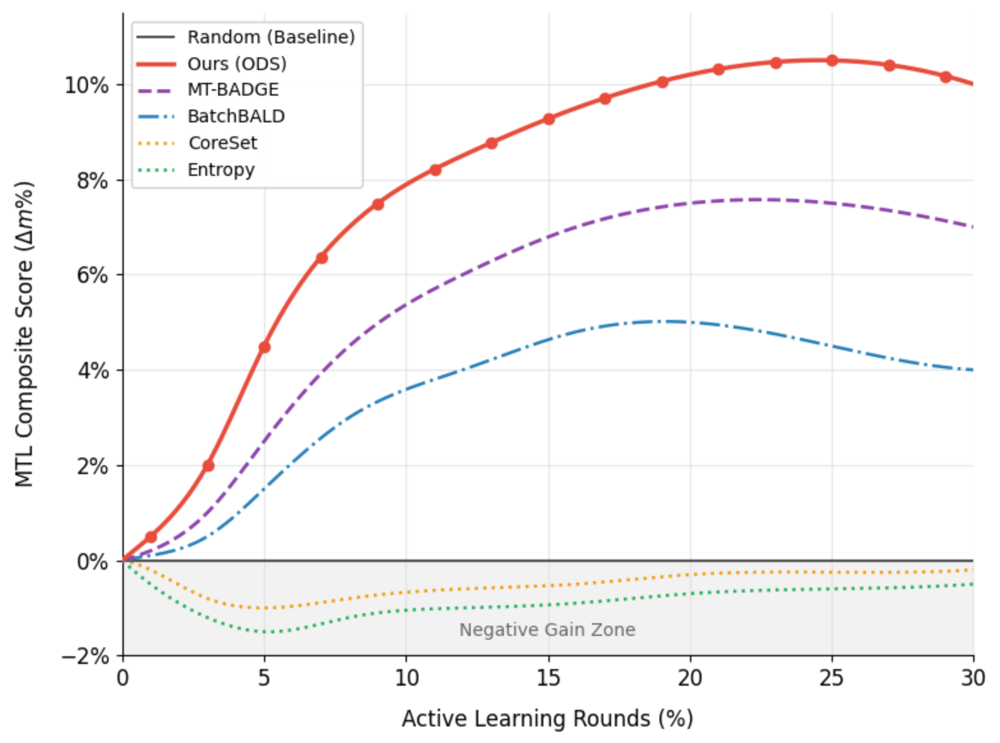

<div align="center">

# Deconstructing Multi-Task Active Learning
### The Paradox of Gradient Conflict and Orthogonal Decomposition

**Juho Jung**<sup>1</sup> · **Seongjae Kang**<sup>2</sup> · **Jinyoung Han**<sup>1,*</sup>

<sup>1</sup>Sungkyunkwan University &nbsp; <sup>2</sup>KAIST &nbsp; <sup>*</sup>Corresponding author

**NeurIPS 2026 (Poster)**

[](#)
[](#)
[](#)
[](LICENSE)

</div>

---

> **TL;DR** Multi-task active learning usually ranks samples by a weighted sum of uncertainty,
> diversity and gradient conflict. We take that sum apart: gradient conflict leaves the
> acquisition score and is handled by the optimizer, and the remaining objectives become two
> ordered stages — filter by informativeness, then maximize coverage among the survivors.

This repository contains the method implementation, all baselines, and every experiment
configuration needed to reproduce the results in the paper.

## Overview

Existing multi-task active learning (MTL-AL) methods score candidates with a *linear
scalarization* of heterogeneous objectives (entropy, feature distance, gradient cosine).
These quantities live in different units, so the weighted sum is dominated by whichever term
has the most extreme values. We replace the sum with three changes:

| | Idea | What it does |
|---|---|---|
| 1 | **Conflict Paradox** | Penalizing gradient conflict in the acquisition score is measurably *worse* than not scoring it at all. ODS therefore leaves conflict out of selection and resolves it at training time with PCGrad. |
| 2 | **Orthogonal Decomposition** | Informativeness and exploration are applied in sequence. Stage 1 keeps the most informative candidates; Stage 2 runs k-Center Greedy only on those, so uninformative outliers cannot dilute the batch. |
| 3 | **CTMI** | Cross-Task Mutual Information: a covariance-based statistic of cross-task dependency computed from MC-dropout task entropies. It rewards samples whose task uncertainties vary independently, where one annotation resolves several separate ambiguities. Forward passes only. |

## Method: Orthogonal Decomposition Selection (ODS)



| Stage | Objective | Operation |
|---|---|---|
| 1 | Informativeness | Rank by `alpha ·` Hardness `+ gamma ·` CTMI, keep the top `pool_factor × B` |
| 2 | Exploration | k-Center Greedy over the Stage-1 candidates |

- **Hardness** — object-wise uncertainty: top-K box entropy (detection), 90th-percentile
  entropy (segmentation), predictive entropy (classification).
- **CTMI** — for each task pair, the absolute correlation of the two entropy sequences across
  MC-dropout passes, averaged over pairs and inverted:

  $$\mathrm{CTMI}(x) = 1 - \mathrm{norm}\Big(\tfrac{1}{|\mathcal{P}|}\textstyle\sum_{(i,j)\in\mathcal{P}} \big|\mathrm{corr}_k\big(H_i^{(k)}(x),\, H_j^{(k)}(x)\big)\big|\Big)$$

  Task uncertainties that rise and fall together point to a single cause, so labeling that
  sample resolves one ambiguity rather than one per task. CTMI is an empirical statistic; it
  makes no distributional assumption and claims no bound on the true mutual information.
- **Training** — the acquisition score contains no conflict term. Whatever gradient conflict
  the selected batch carries is resolved during optimization by PCGrad.

## Results

### COCO (classification + detection + segmentation)

Shared backbone (~2.4M parameters), 3 seeds, round 30. All methods share the backbone and the
training protocol; only the acquisition function differs. Δm is the MTL composite gain over
Random.

| Method | Cls Acc | Det mAP | Seg mIoU | Best Δm | Last Δm | Avg Rank ↓ |
|---|---:|---:|---:|---:|---:|---:|
| Random | 38.42 | 25.21 | 15.10 | 0.0% | 0.0% | 6.33 |
| Entropy | 38.30 | 25.13 | 14.97 | 0.0% | −0.5% | 9.67 |
| Margin | 38.25 | 25.16 | 15.06 | 0.0% | −0.3% | 8.67 |
| Learning Loss | 38.36 | 25.18 | 15.05 | +4.5% | +3.8% | 7.67 |
| CoreSet | 38.26 | 25.14 | 15.01 | 0.0% | −0.2% | 9.33 |
| BADGE | 40.09 | 26.11 | 15.45 | +4.1% | +3.4% | 4.00 |
| BatchBALD | 39.41 | 25.42 | 16.40 | +5.0% | +4.0% | 4.33 |
| MT-BADGE (ext.) | 41.22 | 25.81 | 16.83 | +7.5% | +7.0% | 2.67 |
| PartAL (adapted) | 38.43 | 20.62 | 16.34 | +4.9% | +3.8% | 7.33 |
| Hekimoglu et al. (adapted) | 40.41 | 21.04 | 16.95 | +4.8% | +3.7% | 5.00 |
| **ODS (ours)** | **42.14** | **26.52** | **17.44** | **+10.5%** | **+10.0%** | **1.00** |

<sub>Original comparison protocol (α = 1.8, γ = 0.7, K = 20). Standard deviations are in Table 2 of the paper.</sub>

<p align="center">
  
  <br>
  <sub>MTL composite score (Δm) over rounds on COCO, relative to Random (y = 0).</sub>
</p>

ODS also leads on **Cityscapes** (segmentation, depth, instance; **+8.8%** over Random) and
**NYUv2** (segmentation, depth, surface normals; **+7.5%**). Per-task numbers are in the appendix.

### Conflict ablation

| ID | Selection | Optimizer | MTL composite |
|---|---|---|---:|
| (A) Penalize conflict | Unified score + (1 − \|C<sub>g</sub>\|) | AdamW | 0.0589 |
| (B) Omit conflict | Unified score, no C<sub>g</sub> | AdamW | 0.0756 |
| (C) Rank by conflict | Top-k by measured C<sub>g</sub> | PCGrad | 0.0932 |
| **(D) ODS (ours)** | **Hardness + CTMI, then k-Center** | **PCGrad** | **0.105** |

<sub>(A) vs. (B) is the controlled comparison: same optimizer and pipeline, differing only in
whether a conflict penalty enters the score. (C) uses a different optimizer and is shown for
completeness. The Stage-1 score of (D) has no conflict term.</sub>

### Against recent multi-stage selectors (unified protocol)

Five recent multi-stage selection methods adapted to the multi-task setting, all run under one
protocol (same backbone and schedule, seeds 42 / 123 / 456, Δm paired per seed against the
same-seed Random run).

| Method | s42 | s123 | s456 | Best Δm (%) | Trajectory Δm (%) |
|---|---:|---:|---:|---:|---:|
| FASS (adapted) | +6.00 | +3.17 | +2.75 | 3.97 ± 1.44 | −0.15 ± 0.12 |
| Cluster-Margin (adapted) | +5.70 | +2.27 | +2.50 | 3.49 ± 1.57 | +0.32 ± 0.10 |
| PPAL (adapted) | +5.98 | +1.68 | +1.11 | 2.92 ± 2.17 | +0.08 ± 0.52 |
| 𝔻²-Pruning (adapted) | +7.12 | +1.55 | +1.64 | 3.44 ± 2.61 | +0.09 ± 0.02 |
| SES (adapted) | +7.42 | +0.91 | +4.12 | 4.15 ± 2.66 | +0.41 ± 0.62 |
| **ODS (ours)** | **+7.35** | **+2.34** | **+3.52** | **4.41 ± 2.14** | **+1.03 ± 0.56** |

<sub>Unified protocol (α = 2.5, γ = 0.5, m = 15, K = 15, 31 rounds). *Best* is the peak Δm over
rounds; *Trajectory* is the mean over all rounds. These numbers are **not comparable** with the
COCO table above.</sub>

## Install

```bash
git clone https://github.com/Juho-Jung/multitask_active_learning_official.git
cd multitask_active_learning_official
pip install -r requirements.txt
```

Python 3.8+, PyTorch 1.9+, pycocotools, scikit-learn, matplotlib.

## Data

Every config resolves datasets relative to `./data`. Download into that layout:

```bash
bash scripts/download_coco.sh              # -> ./data/coco
bash scripts/download_datasets.sh          # -> ./data/{nyuv2,cityscapes,brats2021}

python scripts/preprocess_cityscapes.py    # -> ./data/cityscapes_processed
python scripts/preprocess_nyuv2.py
```

Resulting layout (as produced by the scripts above):

```
data/
├── coco/
│   ├── images/{train2017,val2017}/
│   └── annotations/annotations/instances_{train,val}2017.json
├── cityscapes/ , cityscapes_processed/
└── nyuv2/
```

The doubled `annotations/annotations/` is what `annotations_trainval2017.zip` unpacks to;
the configs expect it.

If your data lives elsewhere, symlink it to `./data` or override the `coco_root`,
`coco_ann_file`, `coco_test_root`, `coco_test_ann_file`, `cityscapes_root` and `nyuv2_root`
keys in the config. Run outputs and checkpoints go to `./runs` (`save_dir`,
`save_model_path`); both directories are gitignored.

## Reproducing the paper

### Main results — ODS vs. baselines on COCO (original protocol)

```bash
# Ours (ODS)
python run_al.py --config configs/coco/coco_2stage_selection_objectwise.json --device cuda:0

# Baselines
python run_al.py --config configs/coco/coco_coreset.json     --device cuda:0
python run_al.py --config configs/coco/coco_diversity.json   --device cuda:0
python run_al.py --config configs/coco/coco_badge.json       --device cuda:0
python run_al.py --config configs/coco/coco_batchbald.json   --device cuda:0
python run_al.py --config configs/coco/coco_clustering.json  --device cuda:0
python run_al.py --config configs/coco/coco_hekimoglu.json   --device cuda:0
```

Other benchmarks:

```bash
python run_al.py --config configs/cityscapes/cityscapes_2stage_selection.json --device cuda:0
python run_al.py --config configs/nyuv2/nyuv2_2stage_selection.json          --device cuda:0
```

### Linear scalarization vs. ODS (diversity dilution)

```bash
bash scripts/run_linear_vs_ods.sh
```

### Recent multi-stage baselines (unified protocol)

ClusterMargin, PPAL, FASS, D2-Pruning and SES, each over three seeds, plus ODS and Random
under the same protocol:

```bash
bash scripts/run_unified_protocol.sh <config_name> <gpu_id>   # e.g. mt_ppal_s42 0
# or a single run
python run_al.py --config configs/unified_protocol/mt_ppal_s42.json          --device cuda:0
python run_al.py --config configs/unified_protocol/ods_a2.5_g0.5_m15_s42.json --device cuda:0
python run_al.py --config configs/unified_protocol/mt_random_s42.json        --device cuda:0
```

### Ablations and sensitivity

```bash
bash scripts/run_ablations.sh               # component ablation + alpha/gamma sensitivity
bash scripts/run_pretrained_comparison.sh   # scratch vs. ImageNet-pretrained encoder
```

The full α / γ / m grid of the unified protocol is in `configs/unified_protocol/ods_a*_g*_m*_s*.json`.
Score normalization / combination ablations (min-max vs. z-score vs. rank, sum vs. product)
are in `configs/ablations/`.

### Multi-seed runs

`configs/multiseed/` carries seeds 42 / 123 / 456 for ODS and the baselines, and
`configs/pretrained/` the same for the ImageNet-pretrained encoder:

```bash
python run_al.py --config configs/multiseed/ms_ods_s123.json --device cuda:0
# or
bash scripts/run_multiseed.sh ms_ods_s123 0
```

## Configuration

| Key | Meaning |
|---|---|
| `methods` | selection strategy, see the table below |
| `alpha` | Hardness weight (Stage 1) |
| `gamma` | CTMI weight (Stage 1) |
| `pool_factor` | Stage-1 candidate pool multiplier (m) |
| `hardness_mode` | `entropy`, `margin` |
| `ctmi_mode` | `covariance_negative` (default, used in the paper), `covariance_positive` |
| `ctmi_use_mc_dropout`, `ctmi_num_samples` | MC-dropout estimation of per-task entropies (K passes) |
| `use_pcgrad` | gradient-conflict resolution during training |
| `num_rounds`, `batch_size`, `initial_labeled_size` | AL loop budget |
| `adaptive_hyperparameter_scheduling`, `adaptive_schedule` | round-dependent reweighting of α / γ |
| `seed` | random seed |

Selection strategies accepted by `methods`:

| Group | Values |
|---|---|
| Ours | `ours-2stage` (ODS), `ours`, `ours-ctmi`, `ours-synergy` |
| Classic AL | `random`, `uncertainty`, `diversity`, `coreset`, `clustering`, `badge`, `batchbald` |
| Recent AL / data selection | `cluster-margin`, `cluster-margin-ctmi`, `ppal`, `fass`, `d2pruning`, `ses` |
| Multi-task AL | `hekimoglu`, `partial`, `linear-scalarization` |

## Repository layout

```
multitask_active_learning/
├── acquisition.py                # CTMI + hardness acquisition
├── al_selectors.py               # ODS / two-stage / linear-scalarization
├── baseline_selectors.py         # random, uncertainty, diversity, coreset, BADGE, BatchBALD, ...
├── filter_diversify_selectors.py # ClusterMargin, PPAL, FASS, D2-Pruning, SES
├── datasets.py                   # COCO / Cityscapes / NYUv2 multi-task loaders
├── models.py                     # shared encoder + per-task heads
├── metrics.py                    # per-task and MTL metrics
├── runner.py                     # AL loop, training, PCGrad
└── utils.py

configs/    every experiment configuration used in the paper
scripts/    dataset download / preprocessing, experiment drivers
assets/     figures used in this README
run_al.py   main entry point
```

## Citation

If you find this work useful, please cite:

```bibtex
@inproceedings{jung2026deconstructing,
  title     = {Deconstructing Multi-Task Active Learning: The Paradox of Gradient
               Conflict and Orthogonal Decomposition},
  author    = {Jung, Juho and Kang, Seongjae and Han, Jinyoung},
  booktitle = {Advances in Neural Information Processing Systems (NeurIPS)},
  year      = {2026}
}
```

## Acknowledgements

This work was supported by the National Research Foundation of Korea (NRF) grant funded by
the Korea government (MSIT) (No. RS-2023-NR077194) and by the MSIT Global Scholars Invitation
Program (RS-2024-00459638) supervised by the IITP.

## License

MIT — see [LICENSE](LICENSE).
